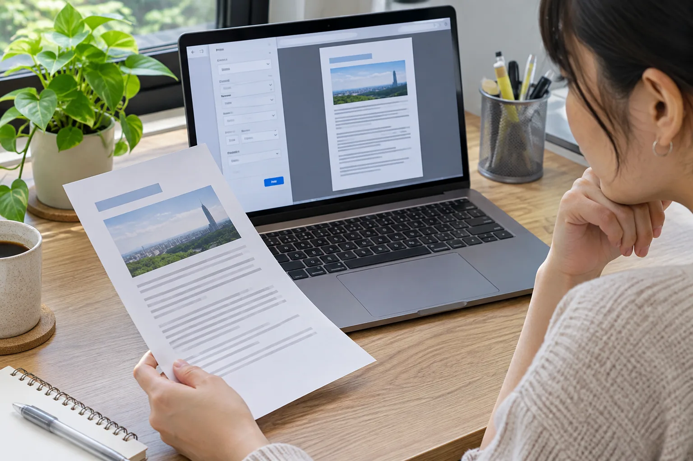

A web article can look excellent on a monitor and still print an entire sheet of navigation before the first paragraph. Open print preview before editing the print stylesheet. The question is concrete: if someone picked up only the first sheet, would they know which article it was and where to start reading?

## Give the first sheet a job

For a procedure someone will use at a desk, the title, revision date and first instruction often matter more than a full-width photograph. For a field guide, the identifying photograph may be essential. Decide what the reader needs on paper before hiding anything.

## Scope the print stylesheet to the output

Use @media print to target navigation, share buttons and other screen controls without affecting the regular page. Be specific about what you hide. A selector aimed at a large layout wrapper can remove the article along with its toolbar.

## Read across the first page break

A heading at the bottom of one sheet and its explanation on the next creates a small but real reading problem. Try break-after on a relevant heading or break-inside on a short figure. Avoid applying keep-together rules to an entire long section that cannot fit on one sheet.

## Test the print stylesheet with a real article

Choose a page with a long URL, a figure caption and several paragraphs. Examine the last lines on page one and the opening lines on page two. A print stylesheet that fixes the opening screenful can still clip a wide block halfway through the document.

## Who added the date at the top?

Browsers can add their own headers and footers. Toggle the corresponding preview option. If the date or address disappears with that setting, changing an article template is unlikely to fix the reader's printer configuration.

## Is saving a PDF a complete test?

It is a repeatable start. Keep paper size and scale constant when comparing versions. For material intended for physical distribution, also print it on the intended device and read the smallest text. The print stylesheet controls document layout; paper margins and printer behavior remain part of the result.

Related reading: [HEAD returned 200. Why a live release still needs GET](https://lijiabao.dev/en/articles/http-head-vs-get-live-content-verification/) · [Why does the same PDF open in one tab and download in another?](https://lijiabao.dev/en/articles/pdf-preview-download-content-disposition/)
