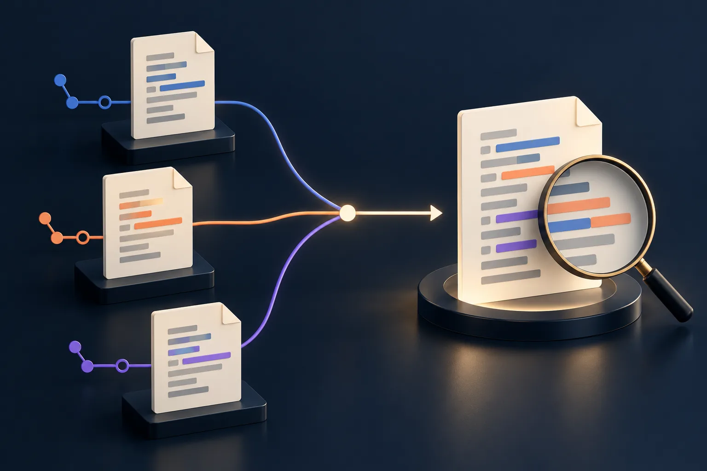

編輯器顯示兩邊版本，按下接受目前變更就能繼續，是否等於衝突已經解決？Git合併衝突首先是內容決策，才是消除標記。`ours`和`theirs`描述特定操作中的兩側，不是永遠對應自己的檔案與別人的檔案；不了解現在進行的是merge還是rebase，就可能在看似成功的操作後，留下缺少需求的版本。

## 先看操作與分支，再看按鈕名稱

開始處理前，用`git status`了解目前是否處於合併或重播中的中斷狀態，記下原分支、目標及本次要整合的工作。這項查看不等於已決定要保留哪一邊，也不需要為了重現畫面再次啟動合併。若專案還有他人留下的未提交修改，先辨認來源與允許處理範圍，不把所有工作目錄差異都納入這次解衝突。

編輯器的目前與傳入等標籤，也應和實際操作一起理解，不只依顏色或左右位置判斷。尤其切換工具後，畫面配置可能不同；操作名稱、分支及內容的意義，比某個固定位置可靠。本文提供檢查思路，沒有替讀者的儲存庫執行任何合併。

## 一般merge和rebase的兩側可能不同

[Git的checkout文件](https://git-scm.com/docs/git-checkout)說明，未合併路徑的`ours`與`theirs`對應索引中的第二與第三階段。一般合併可從目前所在一側與被合入一側理解；進行rebase時，不能沿用自己寫的就一定是ours的記憶。

[rebase文件](https://git-scm.com/docs/git-rebase)進一步說明，重播過程中的ours是目前已重建的系列，從上游開始；theirs則是正在重播的工作分支一側。因此按名稱整份接受之前，要先確認內容真的包含想留下的改動。這不是判斷誰擁有程式碼，也不代表有一個選項在所有情況下比較安全。

## 用同一段需求理解兩份改動

假設一側修正文章網址，另一側補上英文標題，兩份變更可能都需要保留。衝突標記只指出Git未能自動整合的位置，不能回答哪個需求應被捨棄。先讀周圍資料格式與呼叫端，再確認每一側想達成的結果，不把較新的時間當成內容一定正確的理由。

這是說明用的假設，並非實際專案事件。真正處理時，可以對照相關提交與既有驗收要求，說明最後留下什麼、捨棄什麼及原因；不在缺少背景時自行替另一位作者取消功能。若兩個方向確實互斥，先取得對應需求決定，比把兩段文字機械地接在一起更重要。

## 整份選一側之前，確認會一起替換哪些內容

使用整份取用一側的操作，影響可能超過畫面上正在注意的幾行；不要只為了讓紅色標記消失就批次套用到整個資料夾。先看該檔案是否還包含另一邊獨有的修正、資料或語言版本，逐段處理需要保留的部分。標記不見，只代表文字狀態改變，不能證明功能已完整。

產生檔與鎖檔也不能一律靠任意選邊處理。先了解專案使用的來源與產生程序，必要時依既有流程重新產生並檢查結果，不順便升級依賴或重做整個專案。任何超出本次授權的修改，應從這次交付範圍分開，避免一次衝突處理混進難以辨認的變更。

## 加入暫存後，再讀一次準備提交的差異

完成編輯並將明確檔案加入暫存後，使用`git diff --cached`查看準備提交的內容；工作目錄看起來正確，不代表暫存區也已更新。可搭配`git diff --check`找部分空白或衝突標記等問題，但它不驗證程式邏輯、文章語意或兩種語言是否相符。

接著執行與改動相符的建置或檢查，再實際查看受到影響的路徑。沿用[測試通過與功能驗收的區別](/articles/passing-tests-versus-feature-acceptance-evidence/)，檢查完成仍應說明範圍，不用一個綠色結果替未檢查的行為背書。若有殘留未合併路徑，就保留待辦，不把部分檔案完成當成整輪完成。

## 繼續操作之前，留下一份可接續的說明

回報可以包含原本進行的操作、處理的檔案、保留的需求及已通過的檢查，讓接手者知道為何採取這種合併方式。若中斷，不必為了得到乾淨畫面先重設或丟棄他人的修改；先保存狀態，再依專案規則決定如何繼續。

Git合併衝突的完成標準，是最後內容符合需要整合的工作，而不是選對一個英文按鈕。提交與部署也仍是後續不同階段，可再參考[正式站版本的核對方法](/articles/git-commit-cloudflare-production-verification/)。把內容決策、版本交付和公開驗證分開，才能在有問題時找回真正缺少的那一步。
