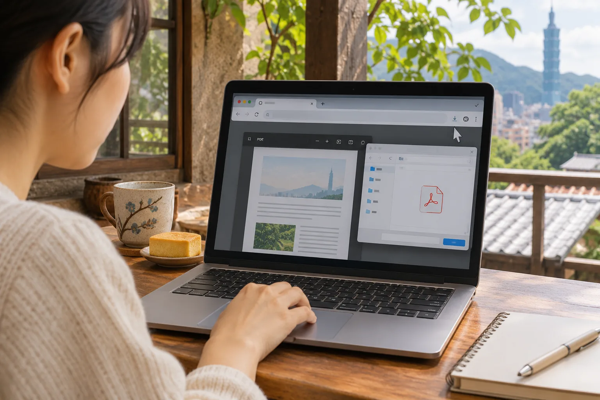

點「閱讀手冊」卻跳出儲存視窗，客服收到這種回報時，先問一件事：對方是直接開啟檔案網址，還是點了網頁裡的下載按鈕？即使最後取得同一份 PDF，兩條路仍可能有不同結果。Content-Disposition 是伺服器對這次回應提出的處理建議，瀏覽器還會考慮連結本身與使用者的設定。

## 從文件的回應找 Content-Disposition

在瀏覽器的網路面板清空舊項目，再操作一次。找出實際回傳 PDF 的請求，檢查其回應標頭。點按鈕後若先經過登入或轉址，別把中途那張 HTML 頁面的標頭抄進紀錄。「文件網址、內容類型、處理方式」這三項要出自同一個最終回應。分享排查紀錄前，記得移除網址裡的臨時存取參數。

## inline 和 attachment 分別告訴瀏覽器什麼？

例如一份真正的 PDF 回傳 application/pdf，Content-Disposition 標成 inline，瀏覽器可以照平常支援的方式呈現它。改成 attachment，伺服器就在提示瀏覽器以附件方式處理。使用者是否看得到另存視窗，取決於瀏覽器怎麼處理下載。有些設定會直接存入下載資料夾。

## 中文檔名要看 Content-Disposition 的哪一段？

filename 可以提供簡單的備用名稱，例如 manual.pdf。要傳中文名稱，filename* 可使用標準的編碼形式。假設畫面顯示「使用手冊」，下載後變成 manual.pdf，先確認伺服器實際送出了哪個參數。不要看到檔名不同，就推定文件位元或 PDF 字型出了問題。接收端也可能為了符合本機檔名規則而調整字元。

## 直接貼網址與點按鈕，各測一次

先直接開啟文件網址，再回到原頁用按鈕開啟。保留同一台裝置、同一個瀏覽器和同一份文件。若行為有別，查看連結是否使用 download 屬性，以及連結與文件是否同源。支援這種連結的瀏覽器，在部分同源情境會優先採用下載提示；不能用地址列的一次測試代替頁面實際操作。

## 同事能預覽，我卻只能儲存，網站壞了嗎？

先比兩人的最終回應與 PDF 開啟偏好。有些瀏覽器可設定一律下載 PDF；裝置也可能缺少內建檢視器。若回應的 Content-Disposition 和內容類型相同，把注意力移到使用者端，通常比反覆上傳同一份手冊更快查到原因。

交付修正時，讓讀者按原來那顆按鈕，再走一次原來的流程。把實際檔名、是否要儲存，以及哪個環境能預覽寫清楚，就能回答最初那個困擾讀者的問題。

延伸閱讀：[按上一頁看到舊資料，bfcache和HTTP快取是同一件事嗎](https://lijiabao.dev/articles/bfcache-history-navigation-http-cache/)、[no-cache不是不快取，網站更新怎麼分辨瀏覽器與CDN的舊回應](https://lijiabao.dev/articles/cache-control-no-cache-browser-cdn-revalidation/)
