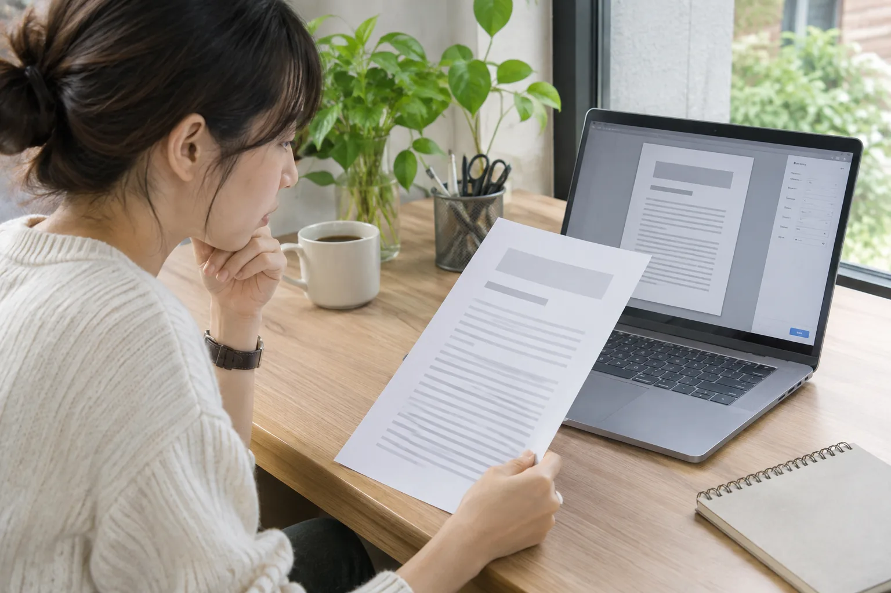

文章在手機上好讀，印出來第一頁卻只有巨大封面和導覽選單。先打開列印預覽，看看讀者拿到第一張紙後能不能辨認文章、讀到開頭，再決定要改哪段列印樣式。

## 第一張紙的任務是什麼？

如果要把教學單張交給同事，第一頁至少應說得出主題、版本或日期，以及從哪裡開始讀。不需要把網頁開頭的每個互動元件都搬到紙上。先確認用途，才知道那張首圖是否值得占半頁。

## 列印樣式如何只影響列印？

CSS 的 @media print 可以放專供列印使用的規則，例如收起導覽和螢幕用的操作按鈕，保留文章標題與必要說明。要精準選到元件；若把包著正文的外層一起隱藏，紙面也會空白。

## 讓標題和第一段一起看

小標剛好落在紙末、說明移到下一張，會打斷操作。可在合適的標題或短圖說使用分頁控制，再回到預覽檢查。不要把長表格或一整個大型區塊全部設成不能切，反而可能推開可用空間。

## 列印樣式測試，為什麼要看第二張？

第一張把導覽藏好了，不代表下一頁沒有漏字。選一篇含長連結、圖說和多段文字的真實文章，查看第一個斷頁前後，確認圖和說明仍對得上。調整列印樣式時，一次只改一類問題，比盲目縮小整份字級好查。

## 預覽裡的網址和日期來自哪裡？

頁首、頁尾的網址或日期有時來自瀏覽器列印設定。先切換預覽中的頁首頁尾選項，比對這行是否消失，再決定是不是網站自己輸出的內容。

## 一定要用實體印表機嗎？

開發時可先用同一紙張大小與縮放比例另存 PDF，比對前後差異。若文件真的要列印交付，再用目標設備確認邊界和小字。列印樣式能整理內容階層，紙張尺寸與設備可列印範圍仍需實測。

延伸閱讀：[HEAD 回傳 200，為什麼正式頁驗收還要做 GET？](https://lijiabao.dev/articles/http-head-vs-get-live-content-verification/)、[為什麼同一份 PDF 有時直接打開，有時卻要下載？](https://lijiabao.dev/articles/pdf-preview-download-content-disposition/)
