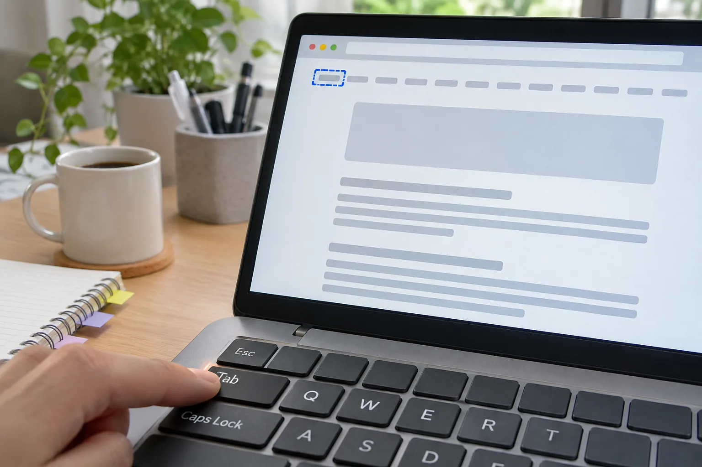

用滑鼠開一篇文章，眼睛可以直接落在標題。只用鍵盤時，首頁、服務、語言和每個次選單卻可能排在正文前面。跳至主要內容連結解決的是這段每天重複的路。要知道它好不好用，得觀察按完 Enter 之後的下一步。

## 第一個 Tab 能不能看到入口？

重新載入文章，先別用滑鼠點頁面，直接按 Tab。略過頁首的入口應該能很早取得焦點；如果為了版面平常先收起來，鍵盤焦點移入時應該清楚顯示。讓連結完全不參與鍵盤操作，等同把需要它的人一起擋在外面。

## 跳至主要內容連結應該指到哪裡？

把連結的頁內目標設在該頁正文起點，例如文章所在的主要內容區。目標識別名稱須和連結片段一致，且在這一頁只出現一次。文章列表和文章詳情可以共用導覽，兩頁的內容起點卻要各自確認。

## 捲動畫面和鍵盤往下走，是兩種觀察

啟動後看見標題，還要再按一次 Tab。這時應從主要內容的位置繼續到合理的下一個可操作項目。如果又回到頁首導覽，可能只有畫面捲動，實際瀏覽順序仍留在原處。用正文裡第一個連結當作觀察點，比只對照捲動位置更準。

## 固定頁首會不會蓋住落點？

換成窄螢幕，讓導覽列收成一列，再試一次。焦點的位置、標題有沒有被頁首擋住、正文裡第一個連結在不在畫面內，都值得分開記。調整捲動留白可以改善遮擋，跳至主要內容連結本身仍須保有有效的目標。

## 跳至主要內容連結和主要地標需要二選一嗎？

不用。主要地標讓支援地標導覽的輔助技術能找到正文，而頁首的鍵盤捷徑也能服務單純使用 Tab 的訪客。用文字表明目的，並依網頁語言提供對應標籤，訪客第一次遇到它時才知道啟動會去哪裡。

## 用一篇長導覽的文章完成驗收

選導覽項目較多的一頁，用鍵盤從頭進入。記下入口是否清楚、啟動後看到哪裡、下一個焦點又在哪裡。當這三個結果都和文章實際結構相符，跳至主要內容連結才真正省下重複操作。

延伸閱讀：[FAQ 用內建展開元件，鍵盤能直接操作嗎？](https://lijiabao.dev/articles/native-details-summary-keyboard-access/)、[看不見不等於讀不到，hidden、aria-hidden與inert各在處理什麼](https://lijiabao.dev/articles/hidden-aria-hidden-inert-visibility-accessibility/)
