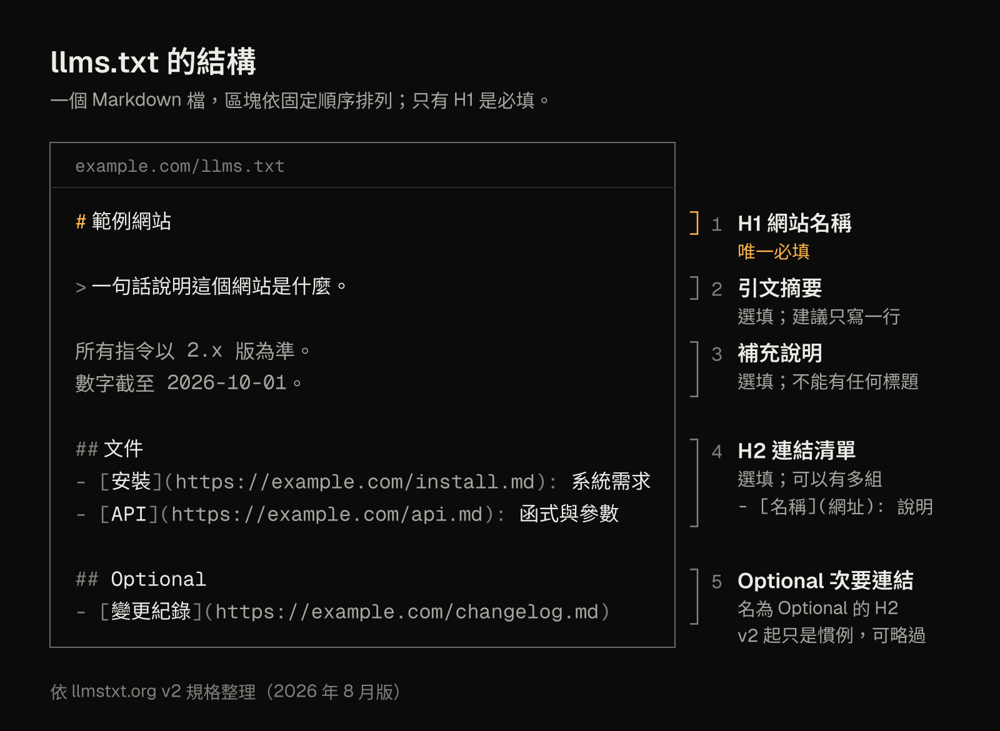

llms.txt 是放在網站上的一個 Markdown 檔，替大型語言模型（LLM）和 AI 代理挑出網站的重點連結並附上說明。它由 Answer.AI 共同創辦人 Jeremy Howard 在 2024 年 9 月 3 日提出，2026 年 8 月更新為 v2。它是社群提案，不是正式標準，不能控制 AI 能不能抓你的網站，也不保證排名或被 AI 引用。

讀完這篇，你會知道 llms.txt 的格式怎麼寫、它和 robots.txt、sitemap.xml 差在哪、Google 與各家 AI 公司實際說過什麼，並能照著繁體中文範本寫出自己的檔案。文末用本站的 [llms.txt](https://lijiabao.dev/llms.txt) 當實例，所有資料截至 2026-10-13。

## llms.txt 是什麼？30 秒看懂

- **它是什麼**：一份給 AI 讀的「導覽清單」。網站作者用 Markdown 寫下網站名稱、一行摘要，再分組列出重要頁面的連結與一句說明。
- **誰提出、何時**：Jeremy Howard（Answer.AI 與 fast.ai 的共同創辦人）在 [Answer.AI 部落格](https://www.answer.ai/posts/2024-09-03-llmstxt.html)發表提案，日期是 2024-09-03。規格網站是 [llmstxt.org](https://llmstxt.org/)，目前標題為「The /llms.txt file, v2」。
- **地位**：規格自稱是「informal overview」，開放社群提供意見。它不是 IETF RFC，也不是 W3C 標準。
- **為什麼需要**：網頁 HTML 夾雜導覽列、廣告與 JavaScript，整個網站又放不進模型的上下文視窗（context window）。提案的想法是，網站作者最清楚哪些內容值得讀，不如直接寫一份精簡清單。

規格也說明了用途：llms.txt 主要預期在**推論時**使用，也就是 AI 代理協助使用者、需要查資料時才去讀，而不是為了模型訓練。



<small>llms.txt 的結構：只有 H1 必填，其餘區塊都是選填，但順序固定（依 llmstxt.org v2）。</small>

## llms.txt 的格式：H1、摘要、連結清單與 Optional

### 區塊與順序

規格規定了區塊的先後順序，但只有 H1 是必填：

| 順序 | 區塊 | 必填？ | 內容 |
| --- | --- | --- | --- |
| 1 | H1（`#`） | 是，唯一必填 | 網站或專案名稱 |
| 2 | 引文（`>`） | 否 | 一段簡短摘要，說明讀者需要先知道的事 |
| 3 | 一般 Markdown 段落 | 否 | 補充說明、注意事項；**不能有任何標題** |
| 4 | H2（`##`）區段 | 否 | 「檔案清單」：每項是 `- [名稱](網址)`，可加 `: 說明` |

檔案開頭可以有位元組順序標記（BOM），這一點在 2026 年 6 月加入規格。

### 連結怎麼寫

每個清單項目必須有 `[名稱](網址)` 形式的 Markdown 連結，後面可以接冒號與一句說明，例如 `- [安裝教學](https://example.com/install.md): 系統需求與三種安裝方式`。規格的寫作建議很簡單：用語精簡清楚、每條連結附一句有資訊量的說明、避免沒有解釋的術語。連結最好指向頁面的 Markdown 版本，而不是厚重的 HTML。

### Optional 區段：從「可略過」變成慣例

名為 `## Optional` 的 H2 區段放次要連結。v1（2024）賦予它特殊意義：需要較短的上下文時，可以略過這一區的網址。v2 的[變更說明](https://llmstxt.org/changes.md)則寫明，Optional 現在只是慣例，**不再帶有機械式的語意**，因為負責展開上下文的工具 `llms_txt2ctx` 已不屬於提案的一部分。這個參考工具本身仍然存在，而且預設仍會略過 Optional。

### 放在哪裡

最常見的位置是網站根目錄的 `/llms.txt`。v2 也允許放在任何路徑，例如 `/docs/llms.txt`，此時它只涵蓋該路徑以下的網址；同時有好幾份適用時，AI 代理應該採用路徑最具體的那一份。規格考慮過 `/.well-known/`（RFC 8615），但因為那只能放在網域根目錄，而很多作者只能控制某個子路徑（例如 GitHub Pages 的專案網站），所以沒有採用。

## llms-full.txt 與每頁 .md：規格裡有什麼、沒有什麼

### 每頁的 Markdown 版本（規格內）

提案建議替每個頁面提供乾淨的 Markdown 版本，放在同一網址加上 `.md`。v1 只有一種寫法：在完整網址後面加 `.md`（`page.html.md`；沒有檔名的網址用 `index.html.md`）。v2 另外允許直接替換副檔名（`page.md`，或 `index.md`）。

### 讓 AI 代理找得到（v2 新增）

v2 定義了兩種連結關係，可以寫成 HTML 的 `<link>` 元素，也可以寫成 HTTP `Link:` 標頭：

- `rel="alternate" type="text/markdown"`：從頁面指向它的 Markdown 版本。
- `rel="describedby"`：從頁面指向涵蓋它的 llms.txt。

標頭寫法的好處是對非 HTML 的資源也有效，而且可以直接在伺服器或 CDN 設定。

### llms-full.txt（規格外的慣例）

很多文章把 llms-full.txt 說成規格的一部分，這不正確：llmstxt.org 的規格在任何版本都沒有定義 llms-full.txt。它是文件平台帶起的慣例，做法是把整個文件網站的內文合成一個 Markdown 檔。[Mintlify 的說明](https://www.mintlify.com/docs/ai/llmstxt)會同時產生 llms.txt 與 llms-full.txt，Mintlify 也[表示](https://www.mintlify.com/customers/anthropic)這個格式是和客戶 Anthropic 一起發展的；這是 Mintlify 自己的說法。

要注意的是檔案大小。2026-10-13 實測，platform.claude.com 的 llms-full.txt 約 43.4 MB，developers.cloudflare.com 的約 67.7 MB，遠超過一般上下文視窗能容納的量。這正是 v2 強調 llms.txt 本身要保持精簡、細節放在連結後面的原因。

## llms.txt、robots.txt、sitemap.xml 差在哪？

三個檔案常被放在一起討論，但用途完全不同：

| | robots.txt | sitemap.xml | llms.txt |
| --- | --- | --- | --- |
| 主要用途 | 告訴爬蟲哪些網址請勿（或可以）抓取 | 列出希望被發現的網址 | 替 AI 挑出重點內容並附說明 |
| 標準地位 | IETF RFC 9309（2022 年 9 月，提議標準） | sitemaps.org 協定 0.90（業界規格） | 社群提案（2024），非 IETF/W3C 標準 |
| 位置 | 主機根目錄 `/robots.txt` | 任意網址，常在 robots.txt 宣告 | 根目錄 `/llms.txt`，v2 允許子路徑 |
| 格式 | 純文字：`User-agent` 群組加 `Allow`/`Disallow` | XML（`urlset`、`url`、`loc`） | Markdown：H1、引文、H2 連結清單 |
| 規模 | 解析上限至少 500 KiB | 每檔最多 5 萬個網址、50 MB | 刻意精簡，要放得進上下文視窗 |
| 能否限制存取 | 不能強制，只是請求 | 不能，只是提示 | 不能，純粹是說明 |
| 對 Google Search 的影響 | 控制 Googlebot 抓取 | 協助發現網址 | 沒有，Google Search 忽略它 |

sitemap 的數字出自 [sitemaps.org 協定](https://www.sitemaps.org/protocol.html)。llms.txt 規格自己也說明了分工：robots.txt 說的是「哪些自動化存取可以接受」，llms.txt 則是代理需要資訊時才去讀；sitemap 不能取代 llms.txt，因為它常常沒有給 LLM 讀的版本、不含外部網址，而且全部網址往往大到放不進上下文視窗。


<small>robots.txt 管抓取偏好，sitemap.xml 給搜尋引擎網址清單；右側是 llms.txt v2 建議的讀取流程，不是實測到的代理行為。llms.txt 不能限制存取。</small>

### 想限制 AI 訓練或 AI 回答，要看 robots.txt

llms.txt 是閱讀清單，不是權限檔。把 `User-agent`、`Disallow` 寫進 llms.txt 不會有任何作用。要表達「可不可以拿去訓練」，應該在 robots.txt 針對各家爬蟲設定：

- **OpenAI**：`GPTBot` 抓取可能用於訓練的內容，`OAI-SearchBot` 用於 ChatGPT 的搜尋功能，兩者可分開設定。由使用者觸發的 `ChatGPT-User`，[OpenAI 說明](https://developers.openai.com/api/docs/bots) robots.txt 規則「可能不適用」。
- **Anthropic**：`ClaudeBot`（訓練）、`Claude-User`（回應使用者提問時擷取）、`Claude-SearchBot`（搜尋品質），[官方說明](https://support.claude.com/en/articles/8896518-does-anthropic-crawl-data-from-the-web-and-how-can-site-owners-block-the-crawler)表示三者都遵守 robots.txt。
- **Google**：`Google-Extended` 是控制權杖，沒有自己的爬蟲，用來決定內容能否用於 Gemini 的訓練與 grounding；[Google 表示](https://developers.google.com/crawling/docs/crawlers-fetchers/google-common-crawlers)它不影響網站是否出現在 Google Search。

另一個選項是 Cloudflare 在 2025-09-24 發布的 [Content Signals](https://blog.cloudflare.com/content-signals-policy/)：在 robots.txt 加一行 `Content-Signal:`，分別表達 `search`（搜尋索引與短摘錄，不含 AI 生成的搜尋摘要）、`ai-input`（即時餵給 AI 模型，例如 RAG）、`ai-train`（訓練或微調）三種用途的偏好。Cloudflare 自己說明，這是偏好，不是技術上的阻擋。

```text
# 範例：允許搜尋，不希望被拿去訓練（Google-Extended 也涵蓋 Gemini 的 grounding）
User-agent: GPTBot
User-agent: ClaudeBot
User-agent: Google-Extended
Disallow: /

User-agent: *
Content-Signal: search=yes, ai-input=yes, ai-train=no
Allow: /

Sitemap: https://example.com/sitemap.xml
```

注意：`Google-Extended` 同時控制 Gemini 的訓練與 grounding，擋掉它也會讓內容不被 Gemini 拿來即時引用；它不影響 Google Search。

兩點提醒。第一，[RFC 9309](https://www.rfc-editor.org/rfc/rfc9309) 寫明 robots.txt 的規則「不是一種存取授權」，真的要擋得靠登入或防火牆。第二，Google 的 robots.txt [只支援](https://developers.google.com/crawling/docs/robots-txt/robots-txt-spec) `user-agent`、`allow`、`disallow`、`sitemap` 四個欄位，`Content-Signal` 會被忽略，Search Console 可能顯示「Syntax not understood」，[Cloudflare 文件](https://developers.cloudflare.com/bots/additional-configurations/managed-robots-txt/)表示沒有觀察到對抓取或 SEO 的影響。本站查核的 OpenAI、Anthropic、Google、Perplexity 爬蟲文件，都沒有提到會讀取 `Content-Signal`（2026-10-13）。

各家 AI 爬蟲的官方名稱、群組比對規則，以及 Google 在 2026 年新增的 AI 摘要控制項，另見本站整理的 [AI 爬蟲與 robots.txt 設定說明](https://lijiabao.dev/articles/ai-crawlers-robots-txt/)。

## 哪些 AI 真的會讀 llms.txt？目前的證據

這是最容易被誇大的部分。結論先講：**證據不一致，而且偏向「主要 AI 爬蟲很少抓取，更沒有證據顯示會拿來使用」**。

### Google：Search 不使用，Chrome Lighthouse 會檢查

Google 對 llms.txt 的說法依產品而不同：

- **Google Search**：2026-06-15，Google 在 Search Central 的[生成式 AI 功能最佳化指南](https://developers.google.com/search/docs/fundamentals/ai-optimization-guide)中加入說明：要出現在 Google Search（包括生成式 AI 功能），不需要建立新的機器可讀檔案或 Markdown，因為 Google Search 本身不使用它們；為其他服務維護 llms.txt 完全沒問題，但對 Google Search 的能見度與排名「既無害也無益」。同一份指南把建立 llms.txt 這類檔案列為做 Google Search 時可以忽略的技巧。指南把這類做法稱為「AEO/GEO」技巧；GEO（生成式引擎優化）一詞出自 2023 年的論文〈[GEO: Generative Engine Optimization](https://arxiv.org/abs/2311.09735)〉。
- **John Mueller 的發言**：2025 年 4 月，他在 Reddit 表示就他所知沒有 AI 服務說過會使用 llms.txt，並把它比作 keywords meta 標籤，因為內容是網站自己宣稱的（[Search Engine Journal 報導](https://www.searchenginejournal.com/google-says-llms-txt-comparable-to-keywords-meta-tag/544804/)）。Search Engine Journal 在 2026 年 6 月報導，他在 Google 的 Podcast《Search Off the Record》中補充，llms.txt 無法幫 LLM 判斷該推薦哪個網站，但可能對已經在網站上的代理有幫助（[SEJ 報導](https://www.searchenginejournal.com/googles-mueller-says-llms-txt-cant-help-llms-differentiate-sites/579304/)）。這些是 Mueller 在社群網站與 Podcast 上的發言，Google 的正式文件以上面的指南為準。
- **Google 自己的檔案**：2025-12-03，Search Central 的開發者文件曾出現一份 llms.txt，當天下午就移除（[Search Engine Roundtable 報導](https://www.seroundtable.com/google-adds-llms-txt-to-search-developer-docs-40533.html)），2026-10-13 實測仍是 404。Google 其他網站上的 llms.txt 則還在，[SEJ 的整理](https://www.searchenginejournal.com/googles-llms-txt-guidance-depends-on-which-product-you-ask/575431/)指出 Google 的說法要看是哪個產品。
- **Chrome Lighthouse**（另一個產品）：Lighthouse 13.3.0（2026-05-07）把「Agentic Browsing」類別加入預設設定，其中有 [llms.txt 稽核](https://developer.chrome.com/docs/lighthouse/agentic-browsing/llms-txt)。依 Lighthouse 的[稽核原始碼](https://github.com/GoogleChrome/lighthouse/blob/main/core/audits/agentic/llms-txt.js)，它檢查檔案有 H1、至少一個 Markdown 連結、至少 50 個字元；回應 5xx 或 429（請求過多）判定不通過，404 等其他 4xx 判定「不適用」，因為提供這個檔案「目前是選用的」。這個類別和 SEO 類別是分開的。

![Google 對 llms.txt 公開說法的時間軸，資料截至 2026-10-13：2025 年 4 月，John Mueller 在 Reddit 表示就他所知沒有 AI 服務說過會使用 llms.txt，並把它比作 keywords meta 標籤（個人發言）；2025 年 7 月，Mueller 表示 llms.txt 可能被連結、收錄而讓使用者困惑，可以考慮加上 noindex（個人發言）；2025-12-03，Search Central 文件站出現 developers.google.com/search/docs/llms.txt，當天就移除，2026-10-13 仍是 404；2026-05-07，Chrome Lighthouse 13.3.0 預設加入 Agentic Browsing 類別，含 llms.txt 稽核，網站沒有這個檔案（404）時判定為不適用，這個類別與 SEO 類別分開；2026-06-15，Google Search 官方指南寫明 Google Search 不使用 llms.txt，為其他服務維護它沒問題，對能見度與排名無害也無益，這是目前的正式立場。](../../../assets/articles/what-is-llms-txt/fig-google-llms-timeline.png)

<small>Google 的說法依產品而不同：Search 官方指南說不使用 llms.txt，Chrome Lighthouse 則有一項選用的 llms.txt 稽核。</small>

### AI 公司自己有 llms.txt，不等於它們的爬蟲會讀你的

OpenAI、Anthropic、Google（Gemini API）都替自家開發者文件發布了 llms.txt，2026-10-13 實測都回應 200。但 OpenAI 與 Anthropic 的爬蟲說明只談 robots.txt，沒有把 llms.txt 列為爬蟲會讀取的訊號。本站在 2026-10-13 查核時，沒有找到 OpenAI、Anthropic、Perplexity 或 Google 正式表示會抓取並使用第三方網站 llms.txt 的公開說法。

### 伺服器紀錄與研究數據

- **SE Ranking**（2025-11-07）：檢查約 30 萬個網域，10.13% 有 llms.txt；統計檢定與模型都找不到它和 LLM 引用次數的關聯，拿掉這個變數模型反而更準（[研究](https://seranking.com/blog/llms-txt/)）。
- **Ahrefs**（2026-06-15）：分析 2026 年 5 月約 13.7 萬個網域，其中 28% 有 llms.txt（因樣本來自其客戶，這是偏高的上限）；有檔案的網站中約 97% 整個月沒有任何請求。具名的 AI 機器人（訓練爬蟲、檢索機器人、AI 助理與代理合計）約占請求的 19.5%，其中 GPTBot 最多（4.51%）（[研究](https://ahrefs.com/blog/llmstxt-study/)）。Ahrefs 也提醒，被抓取不等於被使用。
- **Mintlify 與 Profound**（2025-06-27）：25 家公司、7 天的 CDN 紀錄，llms.txt 每站造訪中位數 14 次，同一資料中 llms-full.txt 的中位數是 79 次（[文章](https://www.mintlify.com/blog/how-often-do-llms-visit-llms-txt)）。這是廠商行銷資料，樣本很小。

### 目前最明確的用途：程式開發代理與文件工具

證據最一致的場景是技術文件。規格作者在 v2 變更說明中表示，程式開發代理能穩定地使用這類檔案；Ahrefs 的資料裡，Anthropic 的程式開發代理 Claude-Code 抓取 llms.txt 的次數僅次於 GPTBot，超過所有 AI 搜尋與助理類機器人。換句話說，llms.txt 目前最可能派上用場的，是使用者叫 AI 代理「去查這個函式庫的文件」的時候，而不是搜尋排名。

## 怎麼寫 llms.txt：7 個步驟（附繁體中文範本）

1. **決定範圍**：整站放 `/llms.txt`，或只替某一區放，例如 `/docs/llms.txt`。
2. **寫 H1**：網站或專案名稱。這是唯一必填的部分。
3. **寫一行摘要**：用 `>` 開頭，**只寫一行**。官方參考解析器只會擷取第一個 `>` 行。
4. **（選做）補充說明**：幾行一般文字，例如資料日期、使用注意事項。這裡不能有標題。
5. **用 H2 分組列連結**：每行 `- [名稱](網址): 說明`，連到頁面的 Markdown 版本；次要連結放進 `## Optional`。
6. **提供 .md 版本並宣告**：替頁面產生 `page.md` 或 `index.md`，再用 `<link rel="alternate" type="text/markdown">` 與 `Link: <…/llms.txt>; rel="describedby"` 讓代理找得到。
7. **建置時自動產生並測試**：從和頁面相同的來源產生，避免過期。測試方法是規格建議的：只給 AI 代理這份 llms.txt，問它關於網站內容的問題。也可以跑 Lighthouse 的 Agentic Browsing 稽核。

下面是一份可以直接改用的範本（網域為虛構的 example.com）：

```markdown
# 範例軟體文件

> 範例軟體是一套開源的影像壓縮工具。本檔列出安裝、設定與 API 文件的 Markdown 版本。

所有指令以 2.x 版為準。數字截至 2026-10-01。

## 入門

- [安裝](https://example.com/docs/install.md): 系統需求與三種安裝方式
- [快速上手](https://example.com/docs/quickstart.md): 五分鐘壓縮第一張圖片

## API

- [API 參考](https://example.com/docs/api.md): 所有函式、參數與回傳值
- [錯誤代碼](https://example.com/docs/errors.md): 每個錯誤代碼的原因與處理方式

## Optional

- [版本紀錄](https://example.com/changelog.md): 歷次版本的變更
- [網站地圖](https://example.com/sitemap.xml): 全站網址清單
```

WordPress 外掛 Yoast SEO、AIOSEO，Wix、Mintlify、GitBook 等平台，以及 VitePress、Docusaurus 的外掛都能自動產生；完整清單以 [llmstxt.org 列出的整合](https://llmstxt.org/)為準。

## 常見錯誤

- **沒有 H1，或連結沒有名稱**：H1 是唯一必填，`[名稱]` 缺漏會讓參考解析器失敗。2026-10-13 實測，web.dev 的 llms.txt 就沒有 H1（第一個標題是 `## Docs`），第一條清單項目也少了 `[名稱]`，只有 `(網址)`；有發布不代表符合格式。
- **摘要寫成多行引文**：參考解析器只保留第一行。
- **在說明段落裡放標題**，或在連結清單裡混用 H3。
- **只連到厚重的 HTML**，沒有提供 Markdown 版本。
- **把整站塞進一個巨大的索引**：llms.txt 要放得進上下文視窗；幾十 MB 的 llms-full.txt 也不能取代它。
- **當成存取控制**：在 llms.txt 寫 `User-agent`、`Disallow` 不會有作用，應該寫在 robots.txt。
- **期待 Google 排名或 AI 引用**：Google 官方說無害也無益，SE Ranking 也找不到關聯。
- **和實際頁面不同步**，或寫了頁面沒有的宣稱。這正是 Mueller「網站自己宣稱」批評的重點。
- **讓 llms-full.txt 被搜尋引擎收錄**：Mueller 曾表示 llms.txt [可以考慮加上 noindex](https://www.seroundtable.com/google-noindex-llms-txt-39798.html)，因為別的網站可能連到它而被收錄，使用者點進來會覺得奇怪；複製全站內文的 llms-full.txt 更適用同樣的道理。

## 實例：本站的 llms.txt 怎麼做

本站在 2026-10-01 加入 llms.txt、llms-full.txt、每頁 Markdown 版本與開放式 robots.txt。以下描述的是 2026-10-13 的狀態；發布本文之前，llms.txt 約 4.3 KB。

**結構**。開頭是 H1、一行中英雙語的引文摘要（產生程式的註解寫明，刻意保持一行，因為解析器只讀第一個 `>` 行）、網站標語、標示資料日期的「數字截至 2026-09-30」，以及一行 robots.txt 政策。接著是「頁面（Markdown 版本）」區段，列出首頁、[微光小鎮](https://lijiabao.dev/glimmertown/)、[前沿實驗室](https://lijiabao.dev/frontier/)的中英文版，共 6 條，都連到 `index.md`，例如[微光小鎮頁的 Markdown 版本](https://lijiabao.dev/glimmertown/index.md)。最後的 Optional 區段放 [llms-full.txt](https://lijiabao.dev/llms-full.txt)、sitemap.xml 與 GitHub 連結。依產生程式的註解，GitHub 頁面是 HTML，不是給 LLM 讀的文字，所以放在可略過的區段。

```markdown
# 李家宝 Li Jiabao — lijiabao.dev

> 微光小鎮與前沿實驗室：成文規則、多家廠商的模型、公開紀錄。每個數字都附出處。 GlimmerTown and Frontier Lab: written rules, models from many vendors, a public record. Every number has a source.

…

數字截至 2026-09-30。 Numbers as of 2026-09-30.
搜尋、AI 回答與 AI 訓練，robots.txt 一律允許。 Search, AI answers and AI training are all allowed by robots.txt.

## 頁面（Markdown 版本） · Pages (Markdown versions)

- [微光小鎮 GlimmerTown — 李家宝](https://lijiabao.dev/glimmertown/index.md): 一座原創的等距像素城市：單一 HTML 檔、零依賴、可離線。三條開發線，同一座城。
- [前沿實驗室 — 李家宝](https://lijiabao.dev/frontier/index.md): 1 個治理庫、15 個學科實驗室、150 張問題卡。狀態照實標示。
…

## Optional

- [llms-full.txt](https://lijiabao.dev/llms-full.txt): 全站完整內文：每一頁，中文與英文 · Every page in full, zh-Hant and English
- [sitemap.xml](https://lijiabao.dev/sitemap.xml): 網站地圖 · Sitemap
- [lijiabao1998](https://github.com/lijiabao1998): 19 個作品倉庫（截至 2026-09-30） · 19 work repositories as of 2026-09-30
…
```

**建置時產生**。`astro build` 之後執行 `scripts/llms.mjs`，從建好的 HTML `<main>` 轉成 Markdown，所以內容不會和頁面不同步；任何一條本站連結對不到實際檔案，建置就失敗。本站編輯整理的文章與李家宝本人的觀點分列不同標題，文章會列在「lijiabao.dev 編輯整理（非本人觀點）」之下；本文發布後，Optional 之前就多了這個區段，列出文章索引與本文。

**HTTP 標頭**。每個回應都帶 `Link: <https://lijiabao.dev/llms.txt>; rel="describedby"`；HTML 頁面有 `<link rel="alternate" type="text/markdown">` 指向 `index.md`；`.md` 以 `text/markdown` 回應，並用 `rel="canonical"` 指回 HTML 頁；llms-full.txt（發布本文之前約 57 KB）加上 `X-Robots-Tag: noindex`。這些做法對應 v2 的探索建議。

**robots.txt**。[本站的 robots.txt](https://lijiabao.dev/robots.txt) 設定為 `Content-Signal: search=yes, ai-input=yes, ai-train=yes`、`Allow: /`，並宣告 sitemap。指向 llms.txt 的是一行**註解**，因為 robots.txt 沒有 llms.txt 欄位。

## 常見問題

### llms.txt 能提升 Google 排名，或讓 AI 引用我的網站嗎？

不能這樣期待。Google 官方指南寫明 Google Search 不使用 llms.txt，對排名與能見度無害也無益。其他 AI 服務也沒有官方文件把它列為引用依據，SE Ranking 的研究同樣找不到關聯。

### 可以用 llms.txt 禁止 AI 拿內容去訓練嗎？

不行。llms.txt 是內容導覽，不是存取規則。訓練偏好請寫在 robots.txt，例如針對 `GPTBot`、`ClaudeBot`、`Google-Extended` 設定。robots.txt 本身也只是請求，不是存取授權。

### ChatGPT、Claude、Perplexity 會讀 llms.txt 嗎？

證據不一致。這些公司替自家文件發布了 llms.txt，但爬蟲說明只談 robots.txt。Ahrefs 統計 2026 年 5 月有 llms.txt 的網站中，約 97% 整月沒有任何請求。目前最明確的使用者是程式開發代理。

### 只有幾頁的小網站需要 llms.txt 嗎？

不是必要。它對 Google Search 沒有影響；如果網站會被 AI 代理查詢（例如文件、產品規格），建一份的成本很低；否則先把頁面本身寫好即可。

### llms-full.txt 一定要做嗎？

不一定。規格沒有定義 llms-full.txt。內容多的技術文件站可以考慮；一般網站提供每頁的 Markdown 版本並從 llms.txt 連過去，通常就夠了。如果要做，建議加上 noindex。

### llms.txt 可以用中文寫嗎？要放在哪裡？

可以。規格規定的是 Markdown 結構，沒有限定語言，建議存成 UTF-8。標準位置是根目錄的 `/llms.txt`；v2 也允許放在子路徑，只涵蓋該路徑以下的頁面。

### 怎麼知道有沒有 AI 讀了我的 llms.txt？

看伺服器或 CDN 的存取紀錄，篩選 `/llms.txt` 的請求並比對 User-Agent。User-Agent 可以偽造，必要時用業者公布的 IP 範圍核對，例如 OpenAI 有公布爬蟲的 IP 範圍。被抓取也不代表內容被引用。

## 重點整理

- llms.txt 是 2024 年提出的社群提案：一份 Markdown 導覽清單，只有 H1 必填，2026 年 8 月更新為 v2。
- 它不控制存取，也不影響 Google Search；存取與訓練偏好寫在 robots.txt。
- llms-full.txt 不在規格裡；每頁的 Markdown 版本和 `rel="describedby"` 才是 v2 的建議。
- 主要 AI 爬蟲讀取的證據很少，最受益的是技術文件和會被程式代理查詢的網站。
- 建立成本低，最好在建置時從頁面自動產生。先把頁面本身寫好、robots.txt 設對，llms.txt 是補充，不是捷徑。

想看更多類似的整理，可以瀏覽[本站編輯整理的文章](https://lijiabao.dev/articles/)。
